# 🌐 ArthaAI Master Knowledge Base

Welcome to the centralized Obsidian Knowledge Base for **ArthaAI**. This vault serves as the authoritative, interconnected semantic graph for statutory financial heuristic rules, AMFI/SEBI regulatory frameworks, Indian Income Tax frameworks, and official AMC mutual fund factsheet disclosures.

---

## 🧭 Vault Navigation & Knowledge Clusters

```mermaid
graph TD
    Root["🌐 ArthaAI Master Knowledge Base"] --> PFHub["💰 [[Personal Finance Hub]]"]
    Root --> MFHub["📈 [[Mutual Funds Hub]]"]
    Root --> TaxHub["🏛️ [[Tax Knowledge Hub]]"]

    PFHub --> R1["📊 [[50-30-20 Budgeting Rule]]"]
    PFHub --> R2["🚗 [[20-4-10 Auto Loan Rule]]"]
    PFHub --> R3["🛡️ [[Emergency Fund Adequacy]]"]
    PFHub --> R4["⚖️ [[Debt-to-Income Guidelines]]"]
    PFHub --> R5["🎯 [[Goal Compounding & PMT Heuristics]]"]

    MFHub --> F1["📘 [[Parag Parikh Flexi Cap Fund]]"]
    MFHub --> F2["📗 [[HDFC Nifty 50 Index Fund]]"]
    MFHub --> F3["📙 [[Axis ELSS Tax Saver Fund]]"]
    MFHub --> F4["📕 [[Axis Bluechip Fund]]"]
    MFHub --> F5["🔄 [[SIP & Compounding Framework]]"]
    MFHub --> F6["🔬 [[Portfolio Risk & Overlap Analytics]]"]

    TaxHub --> T1["📑 [[Income Tax Regimes Comparison]]"]
    TaxHub --> T2["🛡️ [[Section 80C Tax Deductions]]"]
    TaxHub --> T3["🏥 [[Section 80D Health Insurance Deductions]]"]
    TaxHub --> T4["💼 [[Standard Deduction Framework]]"]
    TaxHub --> T5["⚖️ [[Tax Disclosures & Legal Disclaimer]]"]

    TaxHub -.-> F3
    R5 -.-> F5
```

---

## 📂 Core Knowledge Domains

### 1. [[Personal Finance Hub]]
- Comprehensive personal balance sheet guidelines, cash flow surplus, debt affordability, emergency liquidity buffers, and financial goal compounding.
- Linked nodes:
  - [[50-30-20 Budgeting Rule]]
  - [[20-4-10 Auto Loan Rule]]
  - [[Emergency Fund Adequacy]]
  - [[Debt-to-Income Guidelines]]
  - [[Goal Compounding & PMT Heuristics]]

### 2. [[Mutual Funds Hub]]
- Official factsheets, asset allocation mandates, overseas investment policies, and tracking error metrics.
- Linked scheme nodes:
  - [[Parag Parikh Flexi Cap Fund]] (Direct Plan - Growth)
  - [[HDFC Nifty 50 Index Fund]] (Direct Plan)
  - [[Axis ELSS Tax Saver Fund]] (Direct Plan - Growth)
  - [[Axis Bluechip Fund]] (Direct Plan)
- Analytical frameworks:
  - [[SIP & Compounding Framework]]
  - [[Portfolio Risk & Overlap Analytics]]
  - [[Section 80C Tax Framework]]

### 3. [[Tax Knowledge Hub]]
- Income Tax Act, 1961 provisions, Old vs New regime comparisons, Section 87A rebate and marginal relief, standard deduction, Chapter VI-A deductions (80C, 80D), and statutory disclaimers.
- Linked nodes:
  - [[Income Tax Regimes Comparison]]
  - [[Section 80C Tax Deductions]]
  - [[Section 80D Health Insurance Deductions]]
  - [[Standard Deduction Framework]]
  - [[Tax Disclosures & Legal Disclaimer]]

---

## 🔗 Official Regulatory Reference URLs
- [Income Tax Department of India](https://www.incometax.gov.in/)
- [SEBI Investor Education Portal](https://investor.sebi.gov.in/)
- [Association of Mutual Funds in India (AMFI)](https://www.amfiindia.com/)
- [Reserve Bank of India (RBI) Retail Credit Guidelines](https://www.rbi.org.in/)
